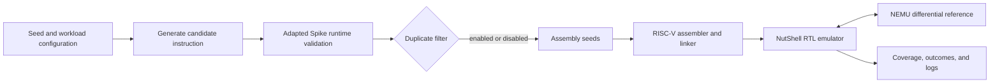
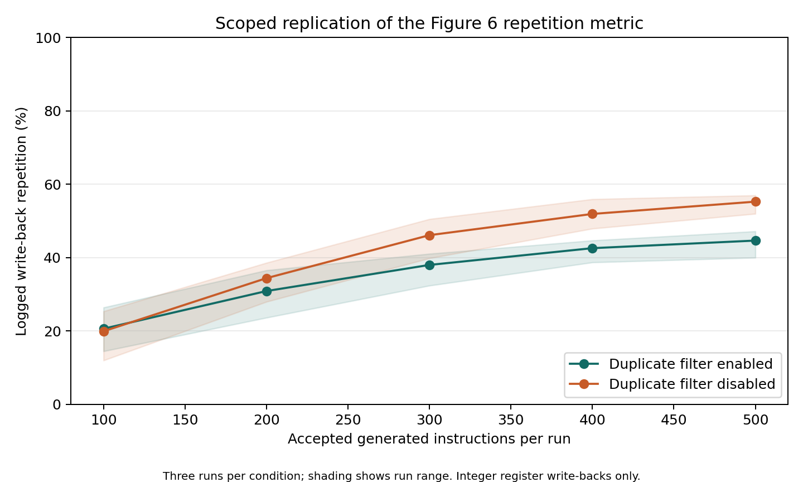

# DiveFuzz phase-two final report

**Team FuzzForge**  
Tharun Arasu Sivakumar, Deepthi Tirumala, Felicia Jeyaseelan

## Motivation and Background

Processor verification must explore a vast space of instructions, operands, execution histories, and architectural states. The DiveFuzz paper identifies repeated write-back values and uneven opcode selection as limitations of existing CPU fuzzers [1]. It constructs instruction sequences using runtime state to increase behavioral diversity. RISC-V defines the architectural behavior expected from a CPU [2]. Differential testing compares the CPU implementation with a reference model, and a mismatch requires investigation before it can be classified as a defect.

## Methodology

We used the pinned NutShell in-order implementation and its differential test harness. The adapted Spike engine validated generation. The generated binary images then executed in the Verilator RTL emulator with NEMU as the differential reference. Two conditions kept runtime validation and known-bug filtering enabled. The enabled condition rejected duplicate signatures. The disabled condition allowed duplicate signatures. Paired repetitions used RNG seeds 1001, 2001, and 3001, a fresh cache per run, one worker, and the same workload size.

## Recommendation: Overall Architecture

The following architecture shows the implemented generation, compilation, and differential execution workflow. The duplicate filter setting is the independent variable. Both conditions use Spike validation and the same target configuration.

## Implementation Details

Hardware: 12th Gen Intel Core i7-12700H, 14 physical cores and 20 logical processors, approximately 23.6 GiB installed RAM. Ubuntu WSL reported approximately 11 GiB available memory and 3 GiB swap. Software: Ubuntu 24.04.4 LTS under WSL2, Python 3.12.3, RISC-V GCC 13.2.0, GNU assembler 2.42, Java 17.0.21.1, Mill 0.11.2, Chisel 3.6.0, and Verilator 5.052. The primary implementation languages are Python, Scala/Chisel, C++, and generated Verilog. Sources, tools, caches, build outputs, and results were stored on F:. NutShell was pinned to commit 63a2687089ec374e6bd19d85ec040caab297dbff.

## Workload and Metrics

The comparison used the NutShell RV64IMC profile with CSR generation, ecall, ebreak, and generated jumps excluded. The initialization template still uses privileged setup instructions. Unique write-back pairs count distinct observed opcode and destination-value pairs from accepted Spike debug events. Coverage is the union of Verilator coverage points hit by the 20 seeds in a run within the NutCore hierarchy, excluding differential wrappers. Generation and RTL times are process wall times; generation includes startup and debug output.

## Time-to-Coverage

To add a common coverage-speed measurement, we replayed the recorded per-seed coverage dumps in campaign execution order. The metric was NutCore Verilator branch coverage, using a common threshold of 6065 covered points, which is 99% of the 6126-point minimum final union across runs. The first seed covers most boot and initialization logic, so an 80% threshold would be reached immediately and would not distinguish the methods; the 99% threshold measures the incremental tail. End-to-end time includes generation, compilation, and RTL execution; RTL-only time starts after generation.

| Filter | Mean seeds to 99% branch target | Mean RTL seconds | Mean end-to-end seconds |
| --- | ---: | ---: | ---: |
| Enabled | 7.3 | 27.26 | 441.79 |
| Disabled | 7.0 | 25.47 | 60.85 |

[Per-run time-to-coverage data](evidence/final/time-to-coverage/branch/summary.csv) · [Seed-by-seed curve](evidence/final/time-to-coverage/branch/curve.csv)

## Full Results

Across six runs, 120 of 120 generated seeds reached a good trap while checked against NEMU. Each run generated and compiled 20 of 20 requested seeds, with 100 accepted workload instructions per seed and 2,000 per run. Mean generation time was 413.3 seconds with filtering enabled and 34.2 seconds disabled. Each run covered 606 of 702 line points. Mean toggle coverage was 71.34% enabled and 71.03% disabled, out of 213,316 toggle points. A later audit found that the parser omitted addiw destination values in these original logs. The unique-pair counts below are therefore counts from an incomplete logged subset and may be biased. The Figure 6 experiment below uses the corrected parser.

| Run | Filter | Pass | Unique pairs | Line | Toggle | Gen. sec | RTL sec |
| --- | --- | --- | --- | --- | --- | --- | --- |
| 1 | disabled | 20/20 | 443 | 86.32% | 71.10% | 34.1 | 70.0 |
| 1 | enabled | 20/20 | 977 | 86.32% | 70.90% | 434.8 | 75.2 |
| 2 | disabled | 20/20 | 486 | 86.32% | 70.94% | 27.5 | 66.8 |
| 2 | enabled | 20/20 | 941 | 86.32% | 71.01% | 299.4 | 77.6 |
| 3 | disabled | 20/20 | 418 | 86.32% | 71.05% | 41.1 | 80.4 |
| 3 | enabled | 20/20 | 924 | 86.32% | 72.10% | 505.6 | 73.0 |

## Insights

The earlier run logged an average of 947.3 distinct observed write-back pairs with duplicate filtering enabled and 449.0 with it disabled, a ratio of 2.11 for the recorded subset. The addiw logging omission affects comparability, so this ratio must not be treated as a reliable estimate for all write-backs. All six runs reached the same line coverage, and the enabled condition took longer to generate the fixed-size corpus. These measurements cannot establish the paper’s reported coverage-speed advantages: our experiment uses one CPU, a restricted workload, an ablation baseline, and different metrics and budgets. Initialization activity, short runs, and different reference models may also affect coverage.

### Paper Figure 6: scoped write-back repetition comparison

The original paper reports approximately 55% weighted write-back repetition for DiveFuzz across its large-scale experiment. Figure 6 compares DiveFuzz with DifuzzRTL and Cascade at instruction counts up to two million [1, Section 5.2, p. 1971].

| Setting | Mean repetition rate | Work per run |
| --- | ---: | ---: |
| Paper: DiveFuzz | Approximately 55% | Up to 2,000,000 instructions |
| Our duplicate filter enabled | 44.62% | 500 accepted instructions |
| Our duplicate filter disabled | 55.23% | 500 accepted instructions |

Each local setting was repeated three times with five 100-instruction seeds per run. All 30 generated programs passed NutShell differential execution.

Our rate is 100 × (1 − distinct opcode/value pairs ÷ logged nonzero integer-register write-back events). This is an operational approximation of the paper’s opcode-weighted repetition rate. We use Spike generator-validation logs, while the paper compares full fuzzers. Stores, floating-point and CSR write-backs, and writes to x0 are not counted in our rate. The filter-disabled setting is our local ablation, not DifuzzRTL or Cascade. The smaller sample, instruction mix, reference execution, and modified artifact prevent a direct numerical equivalence claim.

The paper used an AMD EPYC 9684X machine with 1 TB of memory, Ubuntu 22.04, and Verilator 5.018; our host and tools are described above. The paper’s Figure 6 and Section 5.2 do not specify all details needed to establish identical write-back accounting. We therefore present this as a **scoped investigation of the trend**, with the observed outcome below, not a reproduction of the original two-million-instruction figure.

[Per-run data](evidence/final/paper-figure6/results.csv) · [Analysis details](evidence/final/paper-figure6/summary.json)

## Exception triage

A separate ebreak test completed successfully under Spike and under NutShell without differential testing, while the bundled NEMU comparison reported a different exception cause. A read-only counter-write test passed all three checks. A directed odd pmpcfg CSR test passed on Spike and failed on NutShell alone and in the NEMU differential run. These are reproducible configuration-specific discrepancies requiring upstream and specification review before classifying any as new hardware defects.

## Bug-detection comparison

The generated campaign found 0 confirmed new CPU bugs: all 120 generated seeds passed the selected NutShell/NEMU check. The directed suite had 4 cases: 2 passed, one was a reference-only disagreement (ebreak: NEMU reported cause 2 while Spike and standalone NutShell completed with cause 3), and one was a NutShell discrepancy candidate (odd pmpcfg). The paper reports 26 new bugs and 15 CVE assignments, but those results used historical CPU revisions and a bug corpus that are not present in this checkout. Therefore our result is a completed local detection/triage comparison, not a full re-detection of the paper's 26 bugs.

| Scope | Cases | Passed | Reference-only disagreements | DUT discrepancy candidates | Confirmed new bugs |
| --- | ---: | ---: | ---: | ---: | ---: |
| Generated campaign | 120 | 120 | 0 | 0 | 0 |
| Directed triage | 4 | 2 | 1 | 1 | 0 |

[Machine-readable bug-detection evidence](evidence/final/bug-detection/summary.json) · [Comparison CSV](evidence/final/bug-detection/comparison.csv)

## Discussion

Original paper: its reported evaluation covers four open-source RISC-V CPUs and the authors' selected baselines, coverage metrics, and experimental conditions. Generalization to other architectures and post-silicon behavior requires additional study. Student implementation: the comparison covers one CPU revision, one host, and a restricted workload. The 99% branch time-to-coverage result is measured but dominated by the incremental tail after boot. We did not reproduce the paper's historical bug corpus or confirm any new bug.

## Conclusion

We reproduced and extended a scoped part of DiveFuzz on the NutShell RTL model. All 120 generated test programs passed differential execution under the selected workload. At the 99% common branch-coverage threshold, filtering enabled reached the target in an average of 7.3 seeds and 27.26 RTL seconds (441.79 seconds end-to-end), while filtering disabled reached it in 7.0 seeds and 25.47 RTL seconds (60.85 seconds end-to-end). No new bug is confirmed: one directed case is a reference disagreement and one is a DUT discrepancy candidate. The paper's 26-bug result is not reproduced because its historical buggy revisions and baseline tools are outside this checkout.

## References

[1] Guo et al., [DiveFuzz: Enhancing CPU Fuzzing via Diverse Instruction Construction](https://doi.org/10.1145/3719027.3765167), ACM CCS 2025, pp. 1964–1978.

[2] [RISC-V ISA Manual](https://github.com/riscv/riscv-isa-manual).

[3] [Spike RISC-V ISA simulator](https://github.com/riscv-software-src/riscv-isa-sim).

[4] [DiveFuzz team reproduction repository](https://github.com/tharunarasu/DiveFuzz-Team).

## Appendix: Code, Data, and Reproduction

Full command lines, per-seed logs, and machine-readable results are in [evidence/final/campaign-20261119-184525](evidence/final/campaign-20261119-184525/results.json). The [per-run CSV](evidence/final/campaign-20261119-184525/runs.csv) includes generation and RTL execution times, accepted instructions, opcode counts, write-back events, and repeated values. The [time-to-coverage summary](evidence/final/time-to-coverage/branch/summary.json) and [coverage curve](evidence/final/time-to-coverage/branch/curve.csv) record the common 99% branch threshold. The [bug-detection summary](evidence/final/bug-detection/summary.json) and [comparison CSV](evidence/final/bug-detection/comparison.csv) record generated-seed outcomes and directed triage. Run `scripts/run-final-campaign-f.sh` from WSL as described in [SETUP.md](SETUP.md). Raw coverage files remain on F: and are omitted from Git.
